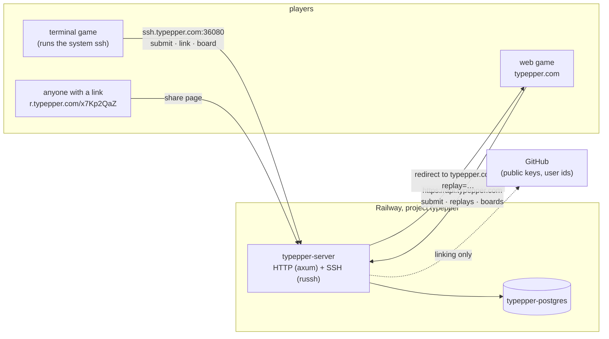
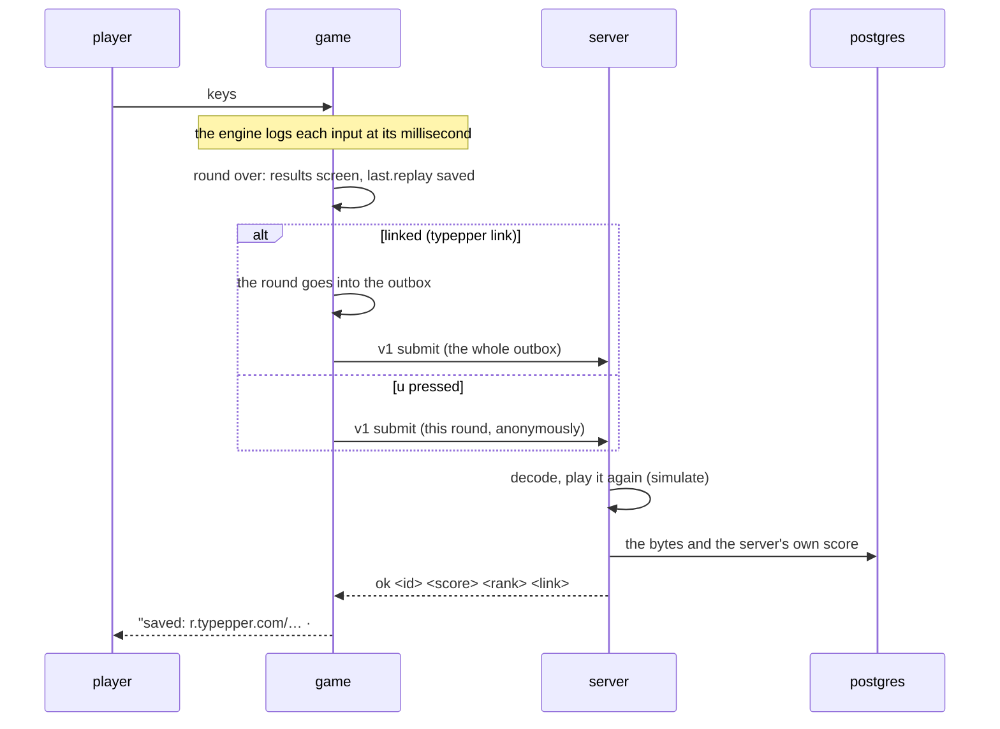

# Architecture

typepper is a typing game that runs in a terminal and in a browser, plus a
small server for sharing replays and keeping leaderboards. This page is the
map; each part has its own doc.

## Principles

1. **Offline first.** The game never needs the network. Nothing is sent at
   startup or while playing; the first possible contact is a finished round,
   and only because the player asked (pressing `u`, opening the boards, or
   having linked their account). A network failure is one dim line of text,
   never a dialog, and never blocks a key. **settings → online: off** turns
   every online feature and hint off.
2. **One set of rules.** The game, the browser and the server run the same
   engine crate, and it's deterministic: the same start and the same keys
   give the same round, on any machine, at any frame rate.
3. **The server trusts no score.** A run is uploaded as its inputs, never its
   result; the server plays it again and keeps its own numbers.
4. **Small, boring infrastructure.** One service and one database on Railway,
   everything declared in the repo, deployed with each release.

## Components



| Host | Serves | Behind |
|---|---|---|
| `typepper.com` | the web game (static: wasm, fonts, installer script) | GitHub Pages |
| `api.typepper.com` | the HTTP API | Railway's edge (port 8080), Cloudflare proxied |
| `r.typepper.com` | share pages (same service) | Railway's edge (port 8080), Cloudflare proxied |
| `ssh.typepper.com` | the SSH door, port **36080** | Railway's TCP proxy (`sakura.proxy.rlwy.net:36080` → 2222), DNS only |
| `docs.typepper.com` | these docs (static, its own service) | Railway's edge (port 8080), Cloudflare proxied |

Railway picks the TCP proxy's port, and released games have it built in, so
the proxy must never be recreated (see [operations](operations.md)).

## The repository

```text
Cargo.toml                 # virtual workspace; every crate shares its version
crates/
├── typepper/              # the game: ratatui UI for the terminal (crossterm) and the web (ratzilla)
├── typepper-engine/       # the rules: no IO, no UI; used by the game and the server
└── typepper-server/       # HTTP + SSH over Postgres; deployed, never released
infra/
├── railway/railway.ts     # the Railway project, as code
├── docker/                # the server's and the docs' images
└── ssh/                   # the server's public host key (the game ships it)
docs/                      # these docs: play/, online/, reference/, built/
site/                      # docs.typepper.com: Zola templates, and prepare.py (docs/ → content)
index.html, web/, assets/  # the web page around the game, and its assets
demo/                      # recording the README's GIFs
mise.toml, mise.lock       # pinned tools and tasks
rust-toolchain.toml        # pinned Rust
```

| Crate | Depends on | Ships as |
|---|---|---|
| `typepper` | `typepper-engine`, ratatui, crossterm / ratzilla | binaries for 5 platforms (cargo-dist), the web build (Trunk) |
| `typepper-engine` | `libm`, `web-time` | part of the other two |
| `typepper-server` | `typepper-engine`, axum, russh, sqlx, ureq | a Docker image on Railway |

`cargo build`, `cargo run` and `cargo test` mean the game
(`default-members`); add `--workspace` or `-p <crate>` for the rest.

## How a round travels



Watching goes the other way: a share link's page sends the browser to
`typepper.com/?replay=<id>`, and the game fetches the bytes and plays them
through the same engine and the same screens, in real time.

## Trust

- **Scores** are computed by the server from the inputs. The client's own
  number travels next to the replay only so mismatches get logged: they'd
  mean the engine ran differently somewhere.
- **Identity** is a GitHub account, proven by an ssh key listed on
  `github.com/<login>.keys`. The game stores only the login, never a token.
- **The server** is proven to the game by its host key, which ships inside
  the game: ssh refuses anything else, and never asks.
- **Not prevented**: a program can type a perfect round. These are a game's
  leaderboards, not an exam.

## Versions

Everything shares the release version (`0.4.0`): the game shows it on the
title screen, the server reports it in `/health`, and a release tag ships the
binaries, the site and the server together. Three things are versioned on
their own, each for its own reason:

| What | Version | Changes when |
|---|---|---|
| the protocol's commands | `/v1`, `v1` | requests or answers change shape |
| the replay bytes | `format` (1) | the byte layout changes |
| the rules | `engine::VERSION` (1) | a change would alter results |
