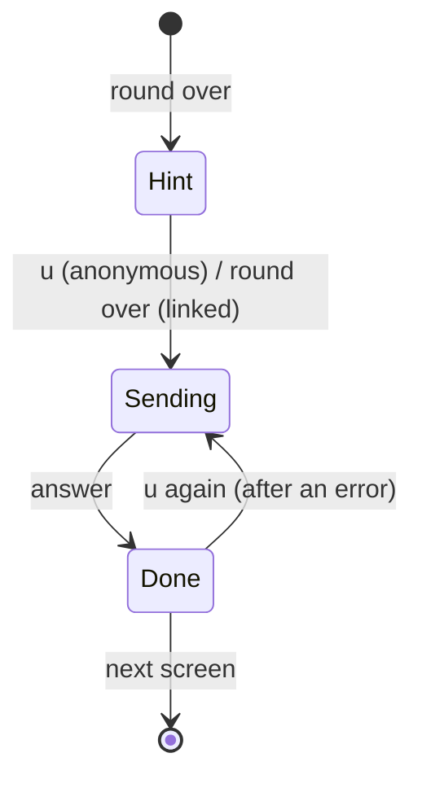

# The game's online side

How `crates/typepper` talks to typepper.com, and the files and flags around
it. The rule for all of it: **nothing happens unless the player asked**, and
nothing blocks the game.

## When the game touches the network

| When | What | Only if |
|---|---|---|
| a round ends, linked | the outbox goes up (`v1 submit`, as the player) | linked, `online` on, not the bot |
| `u` on the results screen | this round goes up anonymously (linked: the outbox again) | `online` on, not a touch screen |
| a linked round's upload answers | `v1 board`, today, for the strip beside the results chart | linked, `online` on, not a touch screen |
| ←/→ on the results screen | `v1 board`, opening the strip at today, then each period | `online` on, not a touch screen |
| `b` on the menu or the results screen, and each period after | `v1 board` | `online` on |
| `typepper link` / `unlink` | `v1 link` / `v1 unlink` | run by hand, in the terminal |
| `l` on the boards, on the web | off to `/auth/github`, or `POST /auth/logout` | pressed |
| `?replay=<id>` on the web | `GET /v1/runs/<id>` | the URL asks for it |
| starting the web game | `GET /v1/me/bests` | logged in, `online` on |

Nothing else at startup, never while playing, never retried in the
background. The bests fetch isn't waited on: the game starts at once, a
best the server has and the browser doesn't (or a higher one) is kept as it
arrives, and a failure changes nothing.

## `online.rs`

The one module that talks to the server. Desktop and web share its shape:

```rust
pub struct Call;                                  // a request under way
impl Call {
    pub fn submit(body: Vec<u8>) -> Result<Call, String>;
    pub fn board(mode: &str, period: &str) -> Result<Call, String>;
    pub fn poll(&mut self) -> Option<Result<String, String>>;   // never waits
}
pub fn submission(replay: &[u8], claimed: Option<f64>) -> Vec<u8>;
pub fn answer(line: &str) -> Result<String, String>;           // a link (and rank), or why not
pub fn rows(text: &str) -> Result<Vec<Row>, String>;            // a board
pub fn account() -> Option<String>;                             // linked, or logged in on the web
pub fn outbox_add(..); pub fn outbox() -> ..; pub fn outbox_settle(..);
// desktop: link(), unlink()   web: log_in(), log_out(), arrived() (reads ?login=)
```

`App::tick` polls every frame; the answer lands whenever it lands.

### Desktop: the system `ssh`

The game runs `ssh` as a child process, with stdin, stdout and stderr
redirected so nothing touches the screen, and kills it after 20 s. The
options make sure it **never prompts**:

```text
ssh -T -p 36080 -l typepper
    -o ConnectTimeout=5 -o LogLevel=ERROR
    -o StrictHostKeyChecking=yes -o HostKeyAlias=typepper
    -o UserKnownHostsFile=<data dir>/known_hosts
    -o PasswordAuthentication=no -o NumberOfPasswordPrompts=1
    -o PubkeyAuthentication=no            # anonymous; =yes once linked
    ssh.typepper.com v1 submit
```

| Option | Why |
|---|---|
| `StrictHostKeyChecking=yes`, `HostKeyAlias`, the game's own `known_hosts` | the server's host key is built in (`infra/ssh/typepper-server.pub`) and written next to the game's data; a different key is refused, and nothing is ever asked |
| `PubkeyAuthentication=no` (anonymous) | no key offered at all: an agent like 1Password would ask its owner to approve one |
| `PubkeyAuthentication=yes` (linked) | keys are offered; the server takes only the linked one, before anything is signed |
| `SSH_ASKPASS` pointing nowhere, `SSH_ASKPASS_REQUIRE=force` | a passphrase-locked key goes to an askpass that isn't there and is skipped, instead of asking over the game |
| no `BatchMode` | `BatchMode` would refuse the server's keyless, question-less login that anonymous sharing relies on |

No `ssh` on the machine: "ssh isn't installed". `typepper link` is the
exception to all this quiet: it runs in the terminal, not the game, so the
agent may ask as it likes.

### Web: `fetch`

`fetch` through `spawn_local`; the answer lands in a slot that `poll` takes.
Submitting copies the link to the clipboard (a canvas has no text to select).
Logged in, it submits to `/v1/me/runs`, and every call carries the session
cookie (`credentials: include`). An `err signed-out` answer forgets
`account`; the outbox keeps its rounds for the next login. **l** on the
boards logs in (the page goes to `/auth/github` and comes back with
`?login=<login>`, kept as `account` and taken out of the address) or out.
Rounds played logged out never join the outbox: on a shared browser, the
next person to log in would claim them. Logged in, the game asks
`/v1/me/bests` as it starts, and `Bests::merge` keeps the higher of each
mode's best, so bests set in the terminal show on the mode cards.

## Sharing and saving



The results screen's bottom line says how it's going:

| | Anonymous | Linked |
|---|---|---|
| before | `u share` | `saved for later` (another upload was running) |
| under way | `sharing…` | `saving…` |
| done | `shared: r.typepper.com/<id>` (web: `copied: …`) | `saved: r.typepper.com/<id> · #3 all time` |
| failed | `couldn't send: <why> · u again` | `couldn't send: <why> · it'll go up with the next one · u now` |

- **One call at a time.** An upload carries on if the player moves to another
  screen (its handle lives on `App`); only the screen it started on talks
  about it.
- **Hidden** with `online: off`, on touch screens (no `u` to press), and under
  someone else's replay.

## The outbox

Linked players' rounds go up by themselves, and survive being offline.

1. **A round ends** (not the bot's, `online` on): it's written as one
   submission item (`claimed | replay`, hex) to `outbox/<unix ms>`. Past 20
   entries, the oldest go.
2. **If no upload is running**, the whole outbox goes up, oldest first, in
   one `v1 submit`.
3. **The answer settles entries**, line by line: `ok`, `old-engine`,
   `bad-replay` and `too-big` remove theirs; anything else, or no answer at
   all, keeps it for the next round.
4. The results line reports the last item: this round.

So a round played on a plane goes up with the first round played back on the
ground. Nothing is ever sent twice: one upload at a time, and entries leave
only once settled.

## Accounts

```sh
typepper link <your-github-login>   # ssh -l <login> … v1 link, in the terminal
typepper unlink                     # v1 unlink, and forgets the account here
```

The game keeps only the login, in `account`; there are no tokens. Linking
needs an ssh key that's on `github.com/<login>.keys`. If ssh doesn't get in,
the game points at ssh's own message, printed just above: either the server
is unreachable, or none of the keys is on that account.

## The boards screen

`b` on the menu opens the board of the selected card's mode, at its
last-picked starting level, starting at today. ←/→ switches today, this week,
this month, this year and all time; each switch is one call. Non-all periods show
"resets in … (UTC)", computed locally (calendar maths in `boards.rs`). The
player's row is highlighted, and shown under the top 20 when it's lower.
Esc goes back.

The results screen has the same board as a strip beside the chart (only on a
column at least 76 wide, and not for zen, which has no score). It opens by
itself once a linked player's upload answers, so it's never behind their own
round; for anyone else, at the first ←/→ press, which is the player's action
(decision 1). A player who isn't on the board sees where this round would
land (`#4?`, a tie going under) as `you, if linked`. ←/→ walks the periods,
and `b` opens the full screen at the same period.

## Files

Under the data dir (`$XDG_DATA_HOME/typepper/`, else
`~/.local/share/typepper/`, else `%APPDATA%\typepper\`), or localStorage as
`typepper.<name>` on the web:

| File | Holds |
|---|---|
| `bests` | personal bests, `<mode name>=<value>` lines (`HOT PURSUIT from lv7=31`) |
| `settings` | theme, effects, font (web), `online=on/off` |
| `last.replay` | the last round played, hex (for `--replay`) |
| `account` | the linked (desktop) or logged-in (web) GitHub login |
| `known_hosts` | the server's host key, rewritten before each ssh call (desktop) |
| `outbox/<unix ms>` | rounds waiting to go up, hex (linked, or logged in) |

## Flags and overrides

| | |
|---|---|
| `typepper --replay [FILE]` | watch the last round, or a replay file |
| `typepper link <login>`, `typepper unlink` | accounts |
| `typepper --version`, `-V` | the version (also on the title screen) |
| `--demo`, `--autopilot [wpm]`, `--flawless`, `--script`, `--fps`, `--light` / `--dark` | the bot and recordings (see `demo/record.sh`) |
| `TYPEPPER_SSH=host:port` | another SSH server (a local one: `localhost:2222`) |
| `TYPEPPER_SSH_KNOWN_HOST="ssh-ed25519 AAAA…"` | the host key to expect there |
| web `?replay=<id>` | play a shared round first |
| web `?login=<login>` | back from logging in (the server sends it) |
| web `?api=http://localhost:8080` | another API (with `trunk serve`) |
| web `?demo`, `?flawless`, `?light`, `?dark`, `?touch` | the bot, themes, touch mode |
