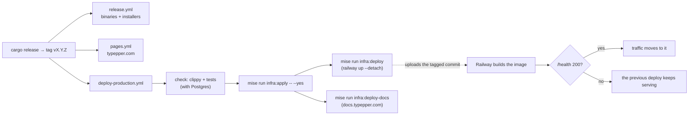

# Operations

Where typepper runs, how it gets there, and what to do when something's off.

## Where things run

| What | Where | Deployed by |
|---|---|---|
| binaries and installers | GitHub Releases | `release.yml` (cargo-dist), on a `v*` tag |
| the web game | GitHub Pages, `typepper.com` | `pages.yml`, on a `v*` tag |
| the server | Railway: project **typepper** (workspace Typepper), environment **production** | `deploy-production.yml`, on a `v*` tag |
| Postgres 18 | Railway, service **typepper-postgres** | declared in `railway.ts` |
| the docs, `docs.typepper.com` | Railway, service **typepper-docs** | `deploy-production.yml`, on a `v*` tag |
| DNS | Cloudflare | by hand |

Production only, for now. A staging environment is worth it once a migration
could hurt real players' data: a `ctx.environment` branch in `railway.ts`, a
`staging` GitHub environment, and a second deploy job.

## Railway

`infra/railway/railway.ts` declares the project with Railway's IaC SDK (the
`railway` npm package; the CLI comes from mise):

| Resource | Settings |
|---|---|
| `typepper-server` | built from `infra/docker/typepper-server.Dockerfile`; health check `/health`; domains `api.typepper.com` and `r.typepper.com` (port 8080); TCP proxy to 2222; 2 vCPU / 2 GB; variables `PORT`, `TYPEPPER_SSH_PORT`, `TYPEPPER_DATABASE_URL` (a reference), `TYPEPPER_SSH_HOST_KEY` (`preserve()`: set in Railway, never in the repo) |
| `typepper-postgres` | Postgres 18; 2 vCPU / 2 GB |
| `typepper-docs` | built from `infra/docker/typepper-docs.Dockerfile` (`site/prepare.py`, Zola, then static-web-server); 0.5 vCPU / 1 GB; health check `/`; domain `docs.typepper.com` (port 8080); variable `PORT` |

- **The service has no GitHub source.** Railway never deploys on its own; only
  `railway up` from CI does.
- **Omitting a resource deletes it.** Applies run with `--yes` but never
  `--confirm-destructive`, so one that would delete anything fails instead.
  Anything added in the dashboard has to be added to `railway.ts` too, or the
  next deploy fails.
- **IaC can't register custom domains.** Add one with
  `railway domain <name> -p 8080 -s typepper-server` (or the dashboard), then
  list it in `railway.ts`.
- **The TCP proxy's port (36080) is in every released game.** Never delete or
  recreate it. `TYPEPPER_SSH` is the escape hatch if it ever happens.

### DNS

| Name | Type | Target | Cloudflare proxy |
|---|---|---|---|
| `api` | CNAME | `6c66j2i7.up.railway.app` | on |
| `r` | CNAME | `howgd9gc.up.railway.app` | on |
| `ssh` | CNAME | `sakura.proxy.rlwy.net` | **off**: Cloudflare's proxy doesn't carry SSH |
| `docs` | CNAME | the target `railway domain` prints for `typepper-docs` | on |

`ssh.typepper.com` must not be added to Railway as a domain: Railway's domains
are HTTP only. SSH goes through the TCP proxy.

## Deploying

A release tag deploys everything together, so the server always runs the
release the game shipped with:



- **Detached:** a green run means Railway accepted the upload. Check that
  `curl -s https://api.typepper.com/health` reports the new `releaseId`.
- **Migrations run when the server starts**, before it serves. They only add,
  so the previous deploy keeps working while the new one comes up.
- **To redeploy a tag** (after an infra change, say):
  `gh workflow run deploy-production.yml --ref vX.Y.Z`.
- **A docs fix, without a release:**
  `gh workflow run deploy-production.yml --ref main -f docs_only=true`. The
  server isn't touched; the docs build from that ref.
- Releasing itself is the [release skill](../../.claude/skills/release/SKILL.md):
  `cargo release`, then watching the runs and checking what landed.

## Secrets

| Secret | Where | Notes |
|---|---|---|
| `RAILWAY_TOKEN` | GitHub environment `Production` | a Railway project token for production |
| `TYPEPPER_SSH_HOST_KEY` | a Railway variable on `typepper-server` | an OpenSSH ed25519 private key; its public half is `infra/ssh/typepper-server.pub` |

### Rotating the SSH host key

Released games have the public key built in, so a new key locks every
installed game out until players update. Rotate only if the key leaked, and
release right after:

```sh
ssh-keygen -t ed25519 -N '' -C typepper-server -f host
railway variable set TYPEPPER_SSH_HOST_KEY --stdin -s typepper-server --skip-deploys < host
cp host.pub infra/ssh/typepper-server.pub && rm host     # commit, then release
```

Don't print the variable while checking it: `railway variables --kv` prints
multi-line values in the clear. Check with `--json` and a parser instead.

## CI

| Workflow | On | Does |
|---|---|---|
| `ci.yml` | pushes to `main`, pull requests | fmt; clippy for the workspace and for wasm; tests with a Postgres 18 service |
| `docs.yml` | pull requests | builds the docs image, as Railway does (a broken link between docs fails it); `.github/docs-check.sh`, not on Dependabot's: code a doc covers changed, so the doc must too, unless the description says `docs: none` |
| `pages.yml` | `v*` tags, by hand | builds the web game with Trunk (from mise) and publishes it |
| `release.yml` | `v*` tags | cargo-dist: 5 platforms, installers, the GitHub Release. **Generated by `dist`: don't edit it** |
| `deploy-production.yml` | `v*` tags, by hand (or the docs only) | checks, then deploys the server and the docs |

### Pinned by hash

| What | Pinned in | Bumped by |
|---|---|---|
| actions | commit SHAs in the workflows | Dependabot (not `release.yml`) |
| Docker base images | `@sha256` in the Dockerfile | Dependabot |
| Rust | `rust-toolchain.toml` (1.95.0) | by hand; keep the Dockerfile's image tag in step |
| railway CLI, Trunk, dist, cargo-release, node, Zola (for `mise run docs`; the docs image has its own) | `mise.toml` + `mise.lock` (checksums per platform) | by hand |
| the Railway SDK | `infra/railway/package-lock.json` | Dependabot |
| Postgres in CI | `@sha256` in `ci.yml` and `deploy-production.yml` | by hand |

Caches only turn over when a pin moves: rust-cache is keyed by the toolchain
and `Cargo.lock` and saved from `main` only; mise-action keys on
`mise.toml`/`mise.lock`; cargo-chef keeps the server's dependency layer on
Railway's builder until the manifests change.

## mise tasks

```sh
mise run server         # the server against a local Postgres 18 in Docker
mise run docs           # the docs site from docs/, at http://127.0.0.1:1111
mise run infra:plan     # what an apply would change (read-only)
mise run infra:apply    # apply railway.ts
mise run infra:deploy   # upload this checkout for Railway to build
mise run infra:deploy-docs  # the same, for docs.typepper.com
```

Every `infra:*` task first checks that this folder is linked to typepper's
Railway project (`TYPEPPER_RAILWAY_PROJECT` in `mise.toml`): an apply deletes
whatever `railway.ts` doesn't name, in whichever project it reaches. An
unlinked folder (a fresh checkout or worktree) gets linked to that project,
production environment, even when a parent folder is linked elsewhere
(railway would otherwise fall back to the parent's project). A folder linked
to another project itself is refused, never relinked. Linking needs
`railway login` first.

## Watching it

- **Health:** `curl -s https://api.typepper.com/health`: `pass` or `fail`,
  the release, the deployment, Postgres' response time.
- **Logs:** `railway logs -s typepper-server`. Worth noticing:
  `runs: … scored X here, Y on the player's side` (the engine ran differently
  somewhere; see [engine](engine.md#determinism)); `health: postgres: …`;
  `sweep: forgot N runs`; `ssh: …` and `github: …` errors.
- **SSH:** `ssh -p 36080 -l typepper ssh.typepper.com ping` → `pong`.

## Runbook

| Symptom | Look at |
|---|---|
| the deploy ran green but nothing changed | `/health`'s `releaseId` and `description`; `railway deployment list -s typepper-server`. A failed build or health check keeps the old deploy serving |
| `deploy-production` fails at apply | `mise run infra:plan`: something exists in Railway that `railway.ts` doesn't name (a dashboard change). Add it to `railway.ts` |
| players: "couldn't reach typepper.com" | `ssh … ping`; DNS for `ssh` (DNS only, to the TCP proxy); `/health` |
| linking: "busy" | GitHub's API answers unauthenticated requests 60 times an hour per address, and Railway's address is shared. An optional `TYPEPPER_GITHUB_TOKEN` would fix it (see [roadmap](roadmap.md)) |
| anonymous shares: "rate-limited" | if many players share one address (Railway's TCP proxy), they share one quota: see [roadmap](roadmap.md) |
| a score mismatch in the logs | the same replay through `simulate` on two platforms; the golden test in CI should have caught a platform difference |

Known: a deploy causes a moment of failed SSH connections at the switch
(about 2 in 45 pings); the game's outbox keeps those rounds for later.
