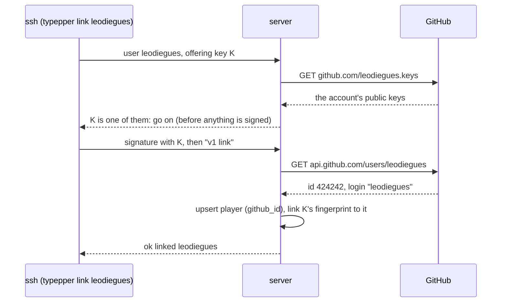

# The server

`crates/typepper-server` is one binary that serves HTTP (axum) and SSH
(russh) over one Postgres. It stores runs, links ssh keys to GitHub
accounts, answers boards, and forgets what no board needs. It's deployed on
Railway with each release and never shipped to players (`dist = false`,
`release = false`).

## Modules

```text
src/
├── main.rs       # config from the environment, migrations, the hourly sweep, HTTP + SSH
├── http.rs       # routes: thin, request → core → response
├── ssh.rs        # the SSH door: auth, commands → core → answer lines
├── runs.rs       # submit (decode, simulate, store), replay bytes, share pages, the quota
├── board.rs      # boards, ranks, the sweep
├── accounts.rs   # players and their ssh keys: link, unlink, who a key is
├── github.rs     # a login's public keys and numeric id, from GitHub
└── id.rs         # random base62 ids, with_new_id
migrations/
├── 0001_runs.sql
├── 0002_players.sql
└── 0003_boards.sql
```

`http.rs` and `ssh.rs` hold no logic: both call the same core functions,
which own their SQL. Queries are plain `sqlx::query` with compile-time
string literals (sqlx 0.9 refuses SQL built at runtime), checked against the
database at runtime, so building needs no database.

## Startup

1. Read the configuration (below). A missing required variable stops it.
2. Connect lazily: the pool is created without waiting for Postgres.
3. Run the migrations (compiled into the binary), retrying for about half a
   minute while Postgres comes up.
4. Start the hourly sweep, then serve HTTP and SSH. If either stops, the
   process exits and Railway restarts it.

## Configuration

| Variable | Default | |
|---|---|---|
| `TYPEPPER_DATABASE_URL` | required | Postgres (on Railway, a reference to `typepper-postgres`'s `DATABASE_URL`) |
| `TYPEPPER_SSH_HOST_KEY` | required | the SSH host key, OpenSSH private key text. Never generated: a new key would make every player's ssh refuse the server |
| `PORT` | 8080 | HTTP (Railway's variable; its domains and health check use it) |
| `TYPEPPER_SSH_PORT` | 2222 | SSH (the TCP proxy's target) |
| `TYPEPPER_GITHUB` | GitHub | points the GitHub calls at a stand-in, for tests |
| `RAILWAY_DEPLOYMENT_ID` | | shown in `/health` |

typepper's own variables are prefixed `TYPEPPER_`.

## Database

The schema is the sum of the migrations. **Migrations only add**: tables,
nullable or defaulted columns, indexes, constraints. Drops and renames wait
for a later release, once nothing reads the old shape. An applied migration
never changes: sqlx checksums them and refuses to start otherwise.

```sql
create table runs (
  id         bigint primary key,
  player_id  bigint references players on delete cascade,  -- null: anonymous
  replay     bytea  not null check (octet_length(replay) <= 1048576),
  engine     int    not null,
  mode       text   not null,               -- Mode::key: 'time:30', 'pursuit:7'
  score      double precision,              -- the server's own; null in zen
  wpm        double precision not null,
  accuracy   double precision not null,
  claimed    double precision,              -- the client's number, to spot drift
  created_at timestamptz not null default now()
);

create table players (
  id         bigint primary key,
  github_id  bigint not null unique,        -- the identity; logins can be renamed
  login      text   not null,               -- refreshed on every link
  created_at timestamptz not null default now()
);

create table ssh_keys (
  id          bigint primary key,
  fingerprint text   not null unique,       -- SHA256:… of the public key
  player_id   bigint not null references players on delete cascade,
  added_at    timestamptz not null default now()
);

-- indexes: runs (created_at); runs (mode, player_id, score desc) and
-- runs (mode, created_at), both where player_id and score are set
```

- **The replay stays a `bytea` in its row.** Postgres moves large values out
  of line (TOAST), and no board reads it. `engine`, `mode` and `score` are
  copied out to be queried; the bytes stay the source of truth, so runs can
  always be re-scored.
- **Deleting a player** removes their keys and runs.

### Ids

Every table's `id` is a random `bigint` in `[0, 62⁸)`, written as 8 base62
characters (`7Xf9qyuC`). Random, so share links can't be counted through;
small, so links stay short and indexes stay integers. Every insert goes
through `with_new_id`, which draws an id and retries only when the insert
collides on a primary key (a constraint ending in `_pkey`). At 62⁸ ≈ 2.2·10¹⁴
that practically never happens; a test forces one.

## Submitting

`runs::submit(db, player, body)` handles both transports:

1. Read items off the body: 8 bytes of claim, then `Replay::decode_prefix`.
   A broken item ends the answer.
2. For each: over 1 MiB → `too-big`; `engine != VERSION` → `old-engine`; a
   mode the game doesn't offer → `bad-replay`.
3. `simulate` the replay **on a blocking thread** (a long zen is millions of
   steps). A round that never ends → `bad-replay`. A claim that differs from
   the server's score is logged.
4. Insert the run with a fresh id; for a linked player, look up their
   all-time rank on that mode.
5. Answer `ok <id> <score> <rank> https://r.typepper.com/<id>`.

## Accounts and linking

A player is a GitHub account; the terminal game is known by an ssh key linked
to it. The SSH **user** says what the connection is for:

| User | Accepted | Means |
|---|---|---|
| `typepper` | a **linked** key (that player), or no key at all | the game; no key, or an unlinked one, means anonymous |
| a GitHub login | a key listed on `github.com/<login>.keys` | "link this key to that account" |



- **Keys are judged when offered**, before the client signs anything. A key
  that won't do is turned down at once, so it never costs its owner an agent
  prompt (1Password, a passphrase).
- **As `typepper`, only linked keys are accepted.** A player with several
  keys is still found; unlinked keys fall through to the next, and finally to
  keyboard-interactive, which lets the game in **anonymously with nothing
  asked**. That's how sharing works without a key. Linking users get no such
  fallback.
- A connection asks GitHub for a login's keys once. Logins are checked first:
  1 to 39 letters, digits or single inner hyphens.
- Re-linking a key moves it to the new account; linking again after a GitHub
  rename updates the login, keeping the player.

Web login (GitHub OAuth, server-side sessions) isn't built yet; see the
[roadmap](roadmap.md).

## Boards

`board::board(db, mode, period, player)` ranks each player's best run on a
mode, for all time or since the current UTC day, week (from Monday), month or
year began. The time zone is explicit in the SQL
(`date_trunc($2, now(), 'UTC')`), whatever the session's.

```sql
with best as (
  select distinct on (r.player_id) r.player_id, r.score, r.created_at
  from runs r
  where r.mode = $1 and r.player_id is not null and r.score is not null
    and ($2::text is null or r.created_at >= date_trunc($2, now(), 'UTC'))
  order by r.player_id, r.score desc, r.created_at
)
select rank() over (order by b.score desc, b.created_at) as rank, …
```

- Only linked players' runs count; anonymous runs never rank.
- Ties go to whoever got there first (`created_at`).
- Top 20, plus the caller's own row when it's below them.
- Runs from every engine version share a board. If a balance change ever
  skews scores, the fix is one more condition, `and engine = $3`.

## The sweep

Hourly, in `main.rs`: delete runs older than **8 days** unless they're a
player's best for their mode in their **calendar month** (UTC).

- 8 days keeps the day and week boards whole, with a day's margin for Sunday
  night.
- A month's best also covers the year's and all time's, since a year's best is
  one of its months' bests.
- Anonymous runs, never anyone's best, go after 8 days, and their share links
  with them.

Long term, that's at most players × modes played × months, about 2 KB each.

## Quota

An in-memory allowance of **60 submissions an hour** per caller: the ssh
key's fingerprint, else the connection's address (HTTP: the first
`x-forwarded-for` address, as Railway's edge passes it). One server, so no
table. Entries older than an hour are forgotten at each call.

## SSH details

- One host key, from `TYPEPPER_SSH_HOST_KEY`; its public half is
  `infra/ssh/typepper-server.pub`, built into the game.
- `none` auth is turned down at once, so clients offer their keys.
- 30 s inactivity timeout. `v1 submit` reads stdin until EOF (at most a
  submission's worth) and answers then.
- Exit status 0 with answer lines; 1 for unknown commands and whole-request
  errors (`rate-limited`, `too-big`).

## Tests

| Test | Needs |
|---|---|
| base62 round trips, the share page's text, the quota, GitHub login rules, the health body | nothing |
| a submission end to end (two replays, a wrong claim, junk, an old engine) | Postgres |
| a forced id collision retries | Postgres |
| link, relink after a rename, unlink | Postgres |
| boards: best per player, periods, ties, anonymous runs; the sweep keeps exactly what boards need | Postgres |

The Postgres tests run when `TYPEPPER_TEST_DATABASE_URL` is set, migrating
it first, and pass with a note otherwise. CI provides Postgres 18, Railway's
major version. See [CONTRIBUTING](../../CONTRIBUTING.md#tests).
