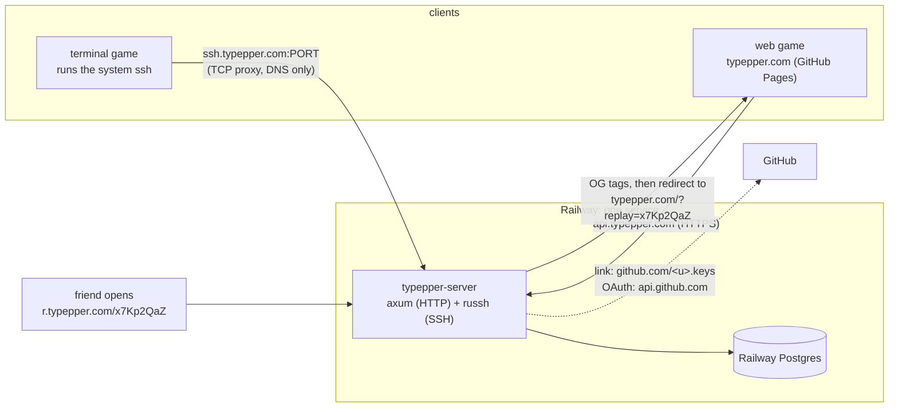
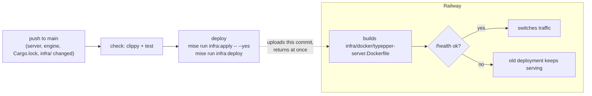

# typepper online: plan and architecture

Leaderboards, accounts and shareable replays, without ever getting in the way
of an offline game.

## Premise

Online is something the player opts into, never something the game needs.

- No network at startup or while playing. The first possible contact is the
  results screen.
- A network failure is one dim line of text, never a dialog, and never blocks
  enter / tab / esc.
- **settings → online: off** hides every online hint for good.

## Architecture



| Host | What | DNS |
|---|---|---|
| `typepper.com` | the web game (GitHub Pages) | as today |
| `api.typepper.com` | HTTP API, auth | Railway HTTP domain |
| `r.typepper.com` | share pages (same service as `api`) | Railway HTTP domain |
| `ssh.typepper.com` | SSH | CNAME to Railway's TCP proxy, DNS only (grey cloud) |

Railway's TCP proxy gives a port it picks, not 22. Players never type it: the
game runs `ssh` itself. `TYPEPPER_SSH=host:port` overrides the address. Never
delete the proxy, or released builds lose their address.

## Deploys

Production only, for now. Staging comes when real player data is worth
protecting (around phase 5): a `ctx.environment` branch in `railway.ts`, a
`staging` GitHub environment and a second deploy job.



- `.github/workflows/deploy-production.yml` deploys; Railway builds the image
  itself (no registry). The service has no GitHub source in `railway.ts`, so
  Railway never deploys on its own.
- The deploy is detached: green CI means Railway accepted the upload. A failed
  build or health check leaves the previous deployment serving.
- The TCP proxy is declared in `railway.ts` (`tcp: [2222]`), so applies keep
  it. `--yes` without `--confirm-destructive`: an apply that would delete
  anything (say, that proxy, whose port is in released games) fails instead.
- Everything is pinned by hash: actions by commit SHA, base images by
  `@sha256`, the toolchain in `rust-toolchain.toml`, the Railway CLI, Trunk,
  dist and cargo-release in `mise.toml` / `mise.lock` (checksums per platform),
  the Railway SDK in `package-lock.json`. Dependabot bumps actions, images and
  npm; mise tools are bumped by hand. Caches turn over only when a pin moves.
- Caching: rust-cache keyed by toolchain + `Cargo.lock`, saved from `main`
  only; mise-action caches the tools, keyed by `mise.toml` / `mise.lock`;
  cargo-chef keeps the dependency layer on Railway's builder until
  `Cargo.lock` changes.
- Locally, the same through mise: `mise run infra:plan` (read-only),
  `infra:apply`, `infra:deploy`, and `mise run server` against a docker
  Postgres. Every `infra:*` task first checks this folder is linked to
  typepper's project (`TYPEPPER_RAILWAY_PROJECT` in `mise.toml`): an apply
  deletes whatever `railway.ts` doesn't name, in whichever project it hits.
- Railway IaC can't register custom domains: `api.` and `r.typepper.com` are
  added in the dashboard, then listed in `railway.ts` so applies keep them.
- **Migrations only add** (tables, nullable or defaulted columns). Drops and
  renames wait for a later deploy, once nothing reads the old shape.

One-time setup: `railway link -w Typepper -p <TYPEPPER_RAILWAY_PROJECT> -e
production` in the repo, a Railway project token as `RAILWAY_TOKEN` in the
`Production` GitHub environment, `TYPEPPER_SSH_HOST_KEY` set in Railway, the two custom
domains in the dashboard, and the DNS records once Railway shows their targets
and the TCP proxy's host and port.

## Repository layout

```text
Cargo.toml                    # virtual workspace, default-members = ["crates/typepper"]
crates/
├── typepper/                 # the game: ratatui UI, recording, outbox, online.rs
├── typepper-engine/          # pure rules, no IO, no ratatui
│   └── src/
│       ├── lib.rs            # VERSION, Mode, Setup, Input, Round, simulate()
│       ├── test.rs, lava.rs  # today's engine.rs / lava.rs rules
│       └── replay.rs         # bytes format v1; knows only `Input` (the mode is its text key)
└── typepper-server/          # (dist = false, not released)
    ├── migrations/0001_init.sql
    └── src/
        ├── main.rs           # env, pool, migrations, start http + ssh + hourly sweep
        ├── http.rs           # thin: request → core → response
        ├── ssh.rs            # thin: command → core → response lines
        ├── id.rs             # Id(i64), random, base62 (8 chars), with_new_id
        ├── auth.rs           # GitHub OAuth, sessions, ssh link
        ├── runs.rs           # submit, store, verify, fetch, share page, sweep
        └── board.rs          # day / week / month / year / all-time boards
infra/
├── railway/                  # Railway IaC; the CLI comes from mise
│   ├── package.json          # the `railway` SDK railway.ts imports
│   └── railway.ts            # service, Postgres, TCP proxy, variables
└── docker/
    ├── typepper-server.Dockerfile             # pinned bases (@sha256), cargo-chef, multi-stage
    └── typepper-server.Dockerfile.dockerignore
rust-toolchain.toml           # pinned toolchain: stable cache keys, no surprise upgrades
mise.toml, mise.lock          # pinned tools (railway, trunk, dist, cargo-release, node) + tasks
.github/
├── dependabot.yml            # bumps action SHAs, image digests, npm pins
└── workflows/deploy-production.yml
```

No `typepper-database` crate: the server is the only thing that talks to
Postgres, and each core module owns its SQL. When a second program needs the
database (an admin CLI, a re-scoring worker), the server becomes a library with
a second binary first.

`http.rs` and `ssh.rs` hold no logic: both call the same core functions
(`runs::submit(&db, caller: Option<PlayerId>, bytes)`), which own their SQL.
Queries are checked at runtime (`sqlx::query`), so the Docker build needs no
database.

`engine::replay` stays self-contained (the mode travels as its text key, not
as `engine::Mode`), so it can become its own crate the day the server runs two
engine versions side by side.

## Engine contract

```rust
/// Bump only when a change alters results: balance, word list, RNG use, timestep.
pub const VERSION: u32 = 1;

pub enum Mode {
    Time(u64),
    Words(usize),
    Zen,
    Survival { start_level: u32 },
    Lava { aim: Aim, start_level: u32 },
    Pursuit { start_level: u32 },
}
impl Mode {
    fn key(self) -> String;            // time:30 words:25 zen survival:4 lava:lock:4 pursuit:7
    fn parse(key: &str) -> Option<Mode>;
    fn start_level(self) -> Option<u32>;
}

pub struct Setup { pub mode: Mode, pub seed: u64 }
pub enum Input { Char(char), Backspace, End }   // End: zen's esc

impl Round {
    fn new(setup: Setup) -> Self;
    fn input(&mut self, at_ms: u32, input: Input);  // runs the fixed steps due first
    fn advance(&mut self, to_ms: u32);              // fixed timestep
    fn result(&self) -> Option<Outcome>;
}
pub fn simulate(setup: Setup, inputs: &[(u32, Input)]) -> Option<Outcome>;
```

The live game, the bot, the web player and the server all drive `Round` the
same way, so a replay reproduces the run exactly. What makes that hold:

- one seeded RNG per round (word picks, mid-run refills, lava spawns):
  SplitMix64 written out in `rng.rs`, not a crate whose algorithm could change
- a fixed timestep: ticks come from the clock, they're never recorded
- times in whole milliseconds from the start of the round
- `libm` for `exp` / `powf` / `ln`, so macOS, Linux and wasm agree to the bit

Tab and esc-to-quit abandon a round; they aren't inputs.

`best::key` and the local bests file stay as they are.

## Protocol

Three layers, each versioned for its own reason:

| Layer | Version | Changes when |
|---|---|---|
| commands | `/v1`, `v1` | the shape of requests or responses changes |
| replay bytes | `format` | the byte layout changes |
| game rules | `engine` | results would change (balance, words, RNG, timestep) |

### Replay bytes (format 1, little-endian)

| Field | Type | Example |
|---|---|---|
| magic | `"TPR"` | `54 50 52` |
| format | `u8` | `01` |
| engine | `u32` | `01 00 00 00` |
| mode | `u8` length + UTF-8 key, ≤ 32 B | `07` `time:15` |
| seed | `u64` | |
| count | varint | `03` |
| inputs | `count` × (`Δms` varint, `op` varint) | |

- Varints are unsigned LEB128: 7 bits per byte, the top bit means "more".
- `Δms`: milliseconds since the previous input (since the round start for the
  first one). Any `u32`: the round's clock just can't pass 2³² ms.
- `op`: `0` Backspace, `1` End, `n ≥ 2` the character `n − 2`. Printable
  ASCII stays one byte.
- About 2.5 B per key: a 60 s blitz is ~1.5 KB.
- At most **1 MB** per replay (about 7 hours of zen at 60 wpm). A longer round
  shows "too long to share" and never enters the outbox.

Example, BLITZ 15s: `h`, then `i` 130 ms later, then backspace 95 ms after:

```text
54 50 52                   "TPR"
01                         format 1
01 00 00 00                engine 1
07 74 69 6d 65 3a 31 35    "time:15"
xx xx xx xx xx xx xx xx    seed
03                         3 inputs
00 6a                      +0 ms    'h'
82 01 6b                   +130 ms  'i'
5f 00                      +95 ms   Backspace
```

Left out on purpose: the score (the server computes it), a checksum or
signature (SSH/TLS already protect the bytes, and the server re-runs every
replay), compression (~2.5 B per key already), Rust enum numbers for the mode
(reordering variants would break old replays).

### Submission

```text
submission = item × ≤ 20             (the whole outbox in one go)
item       = claimed: f64 LE | replay
```

No length prefix: a replay ends where its `count` inputs end. `claimed` is the
client's own score, kept only to log runs the server scores differently.

### Commands

| SSH | HTTP | Does |
|---|---|---|
| `v1 submit`, submission on stdin | `POST api.typepper.com/v1/runs` | stores every run, returns a link; ranks it if the caller is known |
| `-l <github-login> … v1 link` | `/auth/github` → `/auth/callback` (later) | ties this ssh key / browser to a player |
| `v1 whoami`, `v1 unlink` | | the player this key is, or anonymous; let the key go |
| `v1 board <mode> <period>` | `GET /v1/boards/{mode}?period=` | `day`, `week`, `month`, `year`, `all`: the top 20 as `<rank> <score> <login> <day>` lines; over SSH, a linked caller below the top gets a last `me …` line |
| | `GET /v1/runs/{id}` | replay bytes, for the web player |
| `ping` | `GET /health` | readiness: 200 `pass` once Postgres answers, else 503 `fail`; body in the IETF health check format (`application/health+json`: `releaseId`, deployment, Postgres timing) |
| | `GET r.typepper.com/{id}` | OG tags, then redirect to `typepper.com/?replay={id}` |

`/health`, `/auth/*` and share links are unversioned: health is for Railway,
the OAuth callback is registered in the GitHub app, and share links must work
forever.

The web game calls `api.typepper.com` from `typepper.com`: CORS with
credentials, and the session cookie set for `Domain=typepper.com`,
`SameSite=Lax`.

### Responses: one line per item, in order

```text
ok  x7Kp2QaZ  112  14  r.typepper.com/x7Kp2QaZ    # id, server score, rank (or -), link
ok  b3Rt9LmQ  41   -   r.typepper.com/b3Rt9LmQ    # not ranked: anonymous, or not a best
err old-engine    update typepper to submit       # outbox deletes it
err bad-replay    truncated inputs                # outbox deletes it
err busy          try later                       # outbox keeps it
```

Codes: `old-engine`, `bad-replay`, `too-big` (deleted); `busy`,
`rate-limited`, no answer (kept for the next try).

### Server limits, before decoding

- A submission is at most 20 items, each at most 1 MB.
- The mode key is at most 32 B and must parse.
- `count` must match the inputs present; every `op` must be a valid character.
- Anonymous submits are rate-limited per IP (in memory).

## Identity

- **Terminal (first):** the player's ssh key. `typepper link <login>` runs
  `ssh -l <login> … v1 link`: logging in as a GitHub login means "link to it",
  and the server only takes a key listed on `github.com/<login>.keys` (checked
  when the key is offered, before the client signs, so a wrong key never
  costs an agent prompt). It records the GitHub id (logins can be renamed)
  and the key's fingerprint. The game logs in as `typepper` from then on; the
  server takes only a linked key there, so a player with several keys is
  still recognized. `typepper unlink` lets go. The game keeps only the login
  (`account`), no tokens.
- **Web (later, once the GitHub OAuth app exists):** GitHub OAuth. The server
  swaps GitHub's token for its own session (a 256-bit secret in a cookie; only
  its hash is stored) and keeps nothing from GitHub but the user id and login.
- **Anonymous:** an unlinked key, no key at all, or a logged-out browser can
  still submit. The run gets a share link, is never ranked, and expires with
  the sweep.
- Leaderboards show GitHub-linked players only, so names are real handles.

## Database

```sql
create table players (
  id         bigint primary key,
  github_id  bigint not null unique,
  login      text   not null,
  created_at timestamptz not null default now()
);

create table ssh_keys (
  id          bigint primary key,
  fingerprint text   not null unique,
  player_id   bigint not null references players on delete cascade,
  added_at    timestamptz not null default now()
);

create table sessions (
  id         bigint primary key,
  token_hash bytea  not null unique,
  player_id  bigint not null references players on delete cascade,
  expires_at timestamptz not null
);

create table runs (
  id         bigint primary key,
  player_id  bigint references players on delete cascade,   -- null: anonymous
  replay     bytea  not null check (octet_length(replay) <= 1048576),
  engine     int    not null,
  mode       text   not null,
  score      double precision,                               -- null: zen, or an engine it can't run
  wpm        double precision,
  accuracy   double precision,
  claimed    double precision,
  created_at timestamptz not null default now()
);

create index runs_board  on runs (mode, player_id, score desc) where player_id is not null and score is not null;
create index runs_period on runs (mode, created_at)            where player_id is not null and score is not null;
create index runs_age    on runs (created_at);
```

- **Ids:** every table has `id bigint`, random in `[0, 62⁸)`, shown as 8 base62
  characters. Every insert goes through `with_new_id`, which retries only on a
  `*_pkey` collision. Not sequential, so links can't be counted through.
- **Replays stay a `bytea`** in the row: Postgres stores big values out of
  line, and board queries never read it. `engine`, `mode` and `score` are
  copied out for queries; the replay stays the source of truth (re-run it to
  rescore).
- **Deleting a player** cascades to keys, sessions and runs.

### Boards

Calendar periods in UTC (weeks start Monday, `date_trunc('week', now(), 'UTC')`:
the time zone is explicit, whatever the session's), shown with "resets in …".
In the game, `b` on the menu opens the board of the selected card's mode (and
starting level): ←/→ for today, this week, this month, this year and all time,
the player's own row highlighted (and shown under the top 20 when it's lower).
Opening it is the only network call the screen makes. Only the current day / week / month / year is browsable; past
months' bests are kept, so `?period=month&at=2026-09` can come later.

```sql
select * from (
  select distinct on (player_id) id, player_id, score, created_at
  from runs
  where mode = $1 and player_id is not null and score is not null
    and ($2::text = 'all' or created_at >= date_trunc($2, now(), 'UTC'))
  order by player_id, score desc, created_at
) best order by score desc, created_at limit 50;
```

Ties go to whoever did it first. Engine versions share a board until a
balance change skews scores (then: `and engine = $3`).

### Sweep (hourly)

Keep a run if it's from the last 8 days (day and week boards, with a day of
margin for Sunday night), or if it's the player's best for its mode in its
calendar month (which also covers year and all-time).

```sql
delete from runs
where created_at < now() - interval '8 days'
  and id not in (
    select distinct on (player_id, mode, date_trunc('month', created_at, 'UTC')) id
    from runs
    where player_id is not null and score is not null
    order by player_id, mode, date_trunc('month', created_at, 'UTC'), score desc, created_at
  );
```

Long-term rows: at most players × modes played × months, about 2 KB each.

## Game client

- **Recording:** every round appends `(ms, Input)` to a `Vec`. That's all that
  happens during play.
- **Results screen:** a quiet hint, `u share` (not offline, not on touch
  screens). `u` sends this round alone, anonymously; the line then says
  `sharing…`, `shared: r.typepper.com/<id>` (the web copies the link: a canvas
  has no text to select), or `couldn't share: <why> · u again`.
- **Outbox (linked terminal players):** every finished round (not the bot's)
  goes into it and the whole outbox goes up in one `v1 submit`, as the
  player; the results line says `saving…`, `saved: <link>`, or
  `couldn't send: … · it'll go up with the next one`. `ok`,
  `old-engine`, `bad-replay` and `too-big` delete the entry; anything else
  keeps it for the next results screen. Never retried at startup. Hex text
  through `store` (`outbox/<engine>-<unix_ms>`, or `typepper.outbox.*` in
  localStorage), newest 20 kept.
- **Desktop transport:** the system `ssh` as a child process, checked with
  `try_wait()` each tick, never awaited, killed after 20 s:
  `ssh -T -p PORT -o ConnectTimeout=5 -o StrictHostKeyChecking=yes -o HostKeyAlias=typepper -o UserKnownHostsFile=<data dir>/known_hosts -o PubkeyAuthentication=no -o PasswordAuthentication=no ssh.typepper.com v1 submit`,
  stdin, stdout and stderr redirected so nothing touches the screen. Never a
  prompt: the host key is checked (the game ships it, from
  `infra/ssh/typepper-server.pub`), and the server lets a client with no key
  and no password in through keyboard-interactive with nothing asked (which
  `BatchMode` would refuse). No key is offered while sharing is anonymous: an
  agent could ask its owner to approve one. `TYPEPPER_SSH=host:port` and
  `TYPEPPER_SSH_KNOWN_HOST` point it at a local server. No `ssh`: "ssh isn't
  installed".
- **Web transport:** `fetch` through `spawn_local`, landing in a slot `tick`
  reads. `?api=` points it at a local server.
- **Web replay mode:** `?replay=<id>` fetches `/v1/runs/{id}` before the game
  starts and plays it through `Round` and the usual `draw`.
- An upload outlives the screen that started it (the handle lives on `App`).

## Phases

| # | Phase | Done when | Needs |
|---|---|---|---|
| 0 | **Move into `crates/`**: Trunk, cargo-release, dist, CI, README, release skill | `cargo test`, both clippies and `trunk build` pass; `dist plan` and `cargo release` dry-run match today | — |
| 1 | **Server skeleton on Railway**: `/health` (checks Postgres), ssh `ping`, Dockerfile, `infra/railway`, `deploy-production.yml`, pins, DNS, `TYPEPPER_SSH_HOST_KEY`. The first migration comes with the first table, in phase 4 | `curl api.typepper.com/health` and `ssh -p PORT ssh.typepper.com ping` answer | 0 |
| 2 | **Engine crate**: Mode refactor, `Round`, seeded RNG, fixed timestep, `libm`, `VERSION` | a bot round played live and its log run through `simulate` give the same outcome | 0 (parallel with 1) |
| 3 | **Replay format, recording, watching** (no network yet): `engine::replay`, `Mode::key`/`parse`, the last round saved as `last.replay`, `typepper --replay [FILE]` | golden-bytes, round-trip and junk tests pass; a round and its replay end on the same results screen | 2 |
| 4 | **Share**: anonymous `v1 submit` (SSH and HTTP), the `runs` table, `/v1/runs/{id}`, share page, `online.rs`, `u share`, web replay mode, the online setting | a terminal round becomes a link that plays back in a browser | 1, 3 |
| 5 | **Identity, terminal first**: `players`/`ssh_keys` (migration 0002), `v1 link`/`whoami`/`unlink`, `typepper link`/`unlink`, the outbox. Web login (OAuth, sessions, cookies) once the OAuth app exists | a linked key's rounds go up as its player, offline rounds go up later | 4 |
| 6 | **Leaderboards**: indexes (migration 0003), ranks in `submit`, `v1 board` / `GET /v1/boards`, the hourly sweep, the in-game boards screen (`b` on the menu), the rank on the results screen | ranks show on the results screen and the boards; the sweep keeps exactly what boards need | 5 |

## Checks left behind

- **engine:** live round == `simulate` (determinism); replay golden bytes,
  round trip and junk rejection; `Mode::key` round trip over every variant.
- **server:** base62 round trip; `with_new_id` retries a forced collision
  (real Postgres); the sweep keeps the last 8 days and each month's bests and
  nothing else. CI gets a Postgres service container.

## Risks

- **Determinism:** fixed timestep plus `libm` should close it; the
  determinism test and the `claimed` mismatch log watch it.
- **Railway's TCP proxy port** is baked into builds: never recreate it;
  `TYPEPPER_SSH` is the escape hatch.
- **`cargo install --git`** needs the package name once the workspace has two
  binaries; the AUR maintainer needs a heads-up.

## Open

1. Where boards are shown: an in-game screen, a web page, or both.
2. An upload still running when the next round starts: a short note, or drop
   the result.
3. A "delete my data" command (`v1 forget`) in v1 or later.
