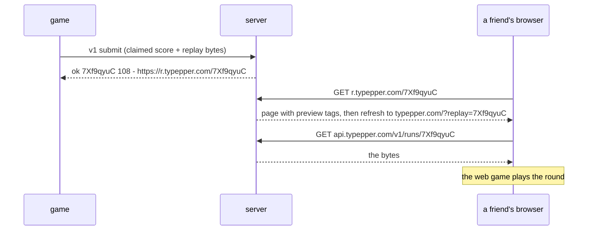

---
extra:
  covers:
    - crates/typepper-engine/src/replay.rs
---

# Replays

A replay is a round's start and every input, at its millisecond. Played
through the engine, it is the round again: the same text, the same heat, the
same score, on any machine. That's what the server scores, what share links
play, and what `typepper --replay` shows. Code: `typepper-engine/src/replay.rs`.

## Format 1

Little-endian, no padding.

| Field | Type | Example | Meaning |
|---|---|---|---|
| magic | 3 bytes | `54 50 52` (`TPR`) | this is a typepper replay |
| format | `u8` | `01` | the byte layout; readers refuse others |
| engine | `u32` | `01 00 00 00` | the rules that recorded it (`engine::VERSION`) |
| mode length | `u8` | `07` | at most 32 |
| mode | UTF-8 | `time:15` | `Mode::key` |
| seed | `u64` | | the round's rng |
| count | varint | `03` | how many inputs follow |
| inputs | `count` × (`Δms` varint, `op` varint) | | |

Everything up to the seed is the **header**: fixed-width and readable
without the engine, so the day the server keeps two engine versions it can
read a replay's version before choosing which engine plays it.

### Varints

Unsigned LEB128: 7 bits per byte, low bits first, the top bit meaning
"another byte follows". `95` is `5f`; `130` is `82 01`; `16384` is
`80 80 01`. A reader stops at 64 bits.

### Inputs

- **`Δms`**: milliseconds since the previous input (since the round started,
  for the first). Gaps under 128 ms take one byte, under 16 s two. Any
  `u32` gap is valid, as long as the running total (the input's time) stays
  within `u32`.
- **`op`**: `0` Backspace, `1` End (zen's esc), and `n ≥ 2` the character
  `n − 2`. Printable ASCII stays one byte; any Unicode scalar value works.

That's about 2.5 bytes a key: a 15 s blitz is about 330 bytes, a 60 s one
about 1.5 KB.

### Example

BLITZ 15s, `h`, then `i` 130 ms later, then a backspace 95 ms after that:

```text
54 50 52                   "TPR"
01                         format 1
01 00 00 00                engine 1
07 74 69 6d 65 3a 31 35    "time:15"
08 07 06 05 04 03 02 01    seed 0x0102030405060708
03                         3 inputs
00 6a                      +0 ms    'h' (0x68 + 2)
82 01 6b                   +130 ms  'i'
5f 00                      +95 ms   Backspace
```

These 35 bytes are the `format_1_bytes_are_these` test: if format 1 changes
by accident, it fails.

### Left out on purpose

- **The score.** The server computes it.
- **A checksum or signature.** SSH and TLS already protect the bytes, and
  the server re-plays every replay anyway.
- **Compression.** ~2.5 bytes a key is already small; deflate would add a
  dependency to save a third.
- **Enum numbers for the mode.** Reordering `Mode`'s variants would silently
  break old replays; its text key can't.

## Decoding

`Replay::decode(bytes)` takes exactly one replay;
`Replay::decode_prefix(bytes)` reads one off the front and returns the rest,
for a submission's back-to-back replays. Neither panics on any input.

| Refused as | When |
|---|---|
| `TooBig` | over 1 MiB (`MAX_BYTES`, about 7 hours of zen at 60 wpm) |
| `NotAReplay` | the magic isn't `TPR` |
| `Format(n)` | a format other than 1 |
| `Truncated` | bytes run out, or `count` claims more inputs than bytes could hold |
| `Mode` | the mode key is over 32 bytes or not UTF-8 |
| `Char` | an op that isn't a Unicode scalar value (a surrogate, past `char::MAX`) |
| `Leftover` | bytes after the last input (`decode` only) |
| `Clock` | the inputs' times run past `u32` ms |

Whether the **mode** is one the game offers, and whether the **engine** is
this one, is checked by whoever plays the replay: `Replay::setup()` parses
the mode, and the server and the game compare `engine` with `VERSION`.

Tests: the golden bytes, round trips (long gaps, `é`, `🌶`, `u32::MAX` ms),
every truncation point, junk, and two replays read off one stream.

## Where replays live

| Where | What |
|---|---|
| the game, after every round | `last.replay` in the data dir (hex text, so localStorage can hold it on the web) |
| the game, linked and not yet sent | `outbox/<unix ms>` (see [game client](game-client.md)) |
| the server | `runs.replay`, a `bytea` next to the server's numbers (see [server](server.md)) |

## Watching

- **`typepper --replay`** plays the last round played on this machine;
  `typepper --replay FILE` plays raw replay bytes from a file. It refuses
  replays from other rules ("recorded by other rules (engine 2, these are 1)")
  and modes this build doesn't have.
- **`typepper.com/?replay=<id>`** fetches `GET api.typepper.com/v1/runs/<id>`
  before the game starts, then plays it. A missing or expired replay
  starts the game normally (and warns in the console).

Either way the replay goes into a fresh `Round` and its inputs land as their
time comes, on the usual screens, under a **REPLAY** banner. Keys are ignored
except esc (back to the menu) and tab or enter (play that mode yourself).
Nothing is saved: it isn't your round.

## Sharing



The share page's title says what happened (`108 wpm · BLITZ 15s · typepper`,
`31 words · HOT PURSUIT from lv7 · typepper`) for link previews; its
`og:image` is the site's. Runs are kept for 8 days, or longer while they're a
player's monthly best; after that the link's page says the replay is gone.
